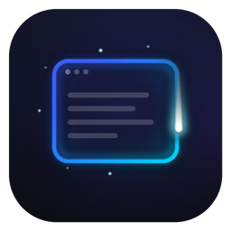
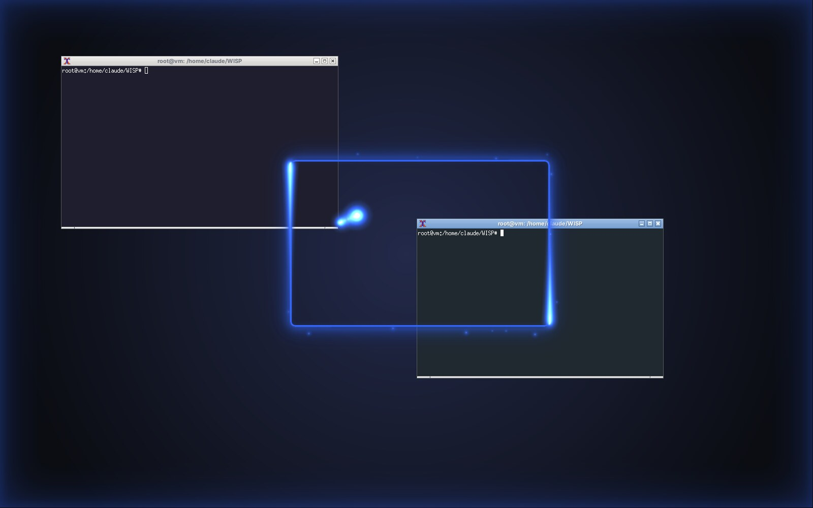
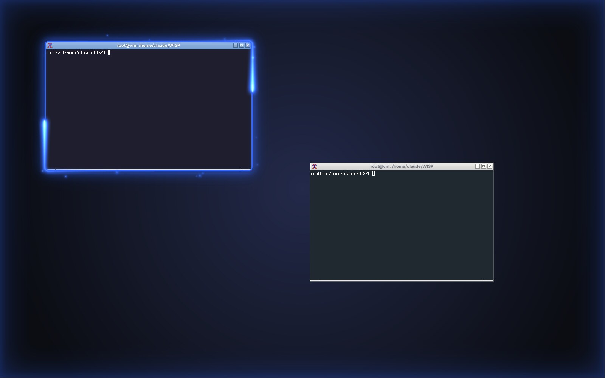
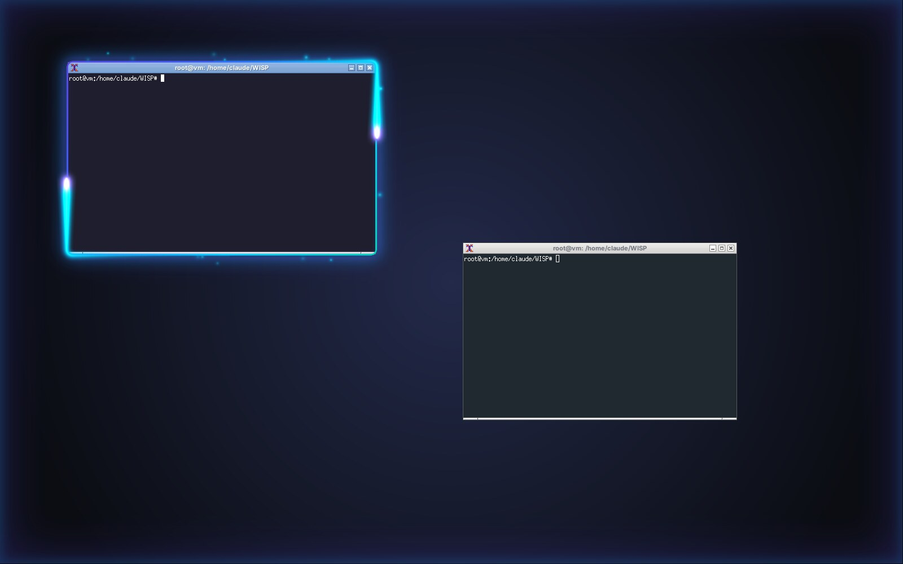
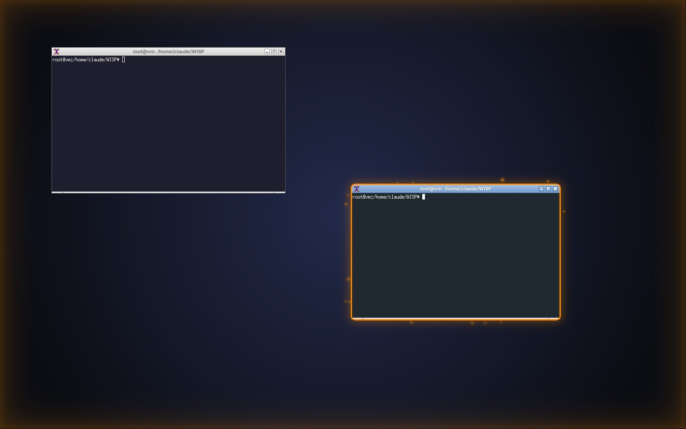
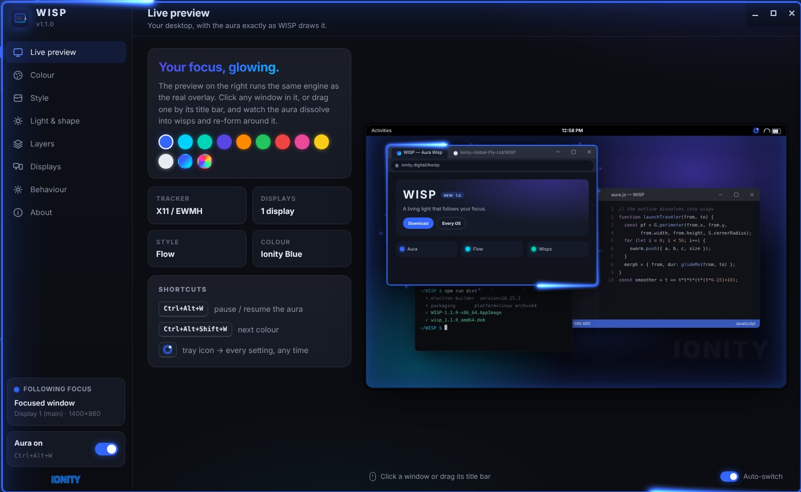
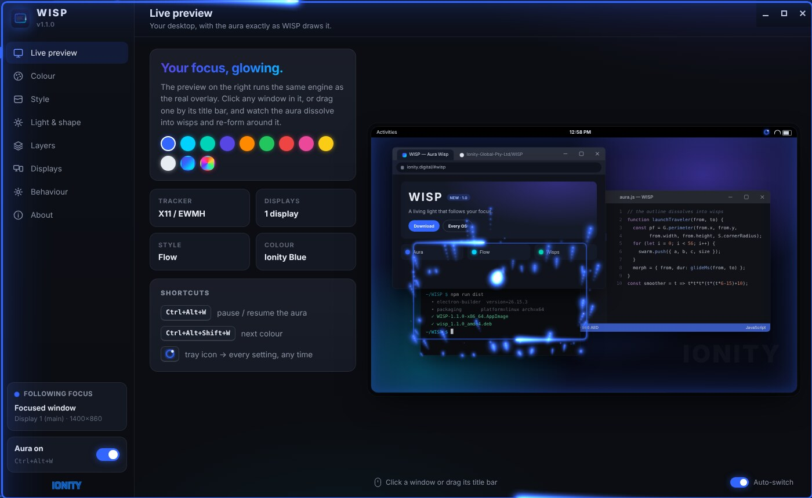

<p align="center">
  
</p>

<h1 align="center">WISP &mdash; Aura Wisp</h1>
<p align="center"><b>A living light that follows your focus.</b><br>
A glowing, colour-changeable aura around the <b>active screen</b> and the <b>active window</b> &mdash; Windows, macOS and Linux.</p>

<p align="center">
  <a href="https://github.com/Ionity-Global-Pty-Ltd/WISP/releases/latest"></a>
  <a href="https://github.com/Ionity-Global-Pty-Ltd/WISP/actions"></a>
  
  
</p>

<p align="center"></p>

---

## What it does

WISP sits in your tray and draws light where your attention is:

- **Active window aura** &mdash; a crisp line and soft glow hugging the window you are working in (the real visible edge &mdash; DWM frame bounds on Windows, CoreGraphics on macOS, EWMH frame extents on Linux).
- **Active screen aura** &mdash; on multi-monitor setups, the display that holds your focus breathes light in from its edges.
- **The puller** &mdash; switch windows and the aura glides smoothly to the new one while its outline dissolves into a stream of wisps that fly across and re-form it, led by a comet and landing in a burst of sparks.
- **Wisps** &mdash; motes of light orbit the frame; in *Flow* style two comets chase each other around the edge.
- **Click-through, always** &mdash; WISP never takes focus, never eats a click, never shows in Alt-Tab, the taskbar or Mission Control.
- **Stays out of the way** &mdash; hides over full-screen games, video and presentations (toggle).

| | |
| --- | --- |
|  |  |
| **Flow** in Ionity Blue | **Ionity Flow** &mdash; the brand gradient |
|  |  |
| **Pulse** in Global Orange | Settings &mdash; everything applies live |
|  | |
| **1.1:** switching windows &mdash; the outline dissolves into wisps that stream across and re-form | |

## Colours & styles

**Colours:** Ionity Blue (default) &middot; Ionity Cyan &middot; Ionity Teal &middot; Ionity Purple &middot; Global Orange &middot; Emerald &middot; Crimson &middot; Rose &middot; Gold &middot; Moonlight &middot; **Ionity Flow** (purple &rarr; blue &rarr; cyan &rarr; teal) &middot; **Spectrum** (rainbow) &middot; any **custom** colour. The tray icon repaints itself in your colour.

**Styles:** *Aura* (steady glow) &middot; *Pulse* (breathing) &middot; *Flow* (light running the edge) &middot; *Wire* (crisp outline, no glow).

**Tune:** thickness, glow, intensity, screen-aura strength, speed, gap from the window, corner radius (auto matches Windows 11 / macOS corners), frame-rate cap.

## Download

Grab the latest from **[Releases](https://github.com/Ionity-Global-Pty-Ltd/WISP/releases/latest)** or **[ionity.digital](https://ionity.digital/#wisp)**.

| Platform | File |
| --- | --- |
| Windows 10 / 11 &mdash; installer | `WISP-Setup-<ver>-x64.exe` &middot; `WISP-Setup-<ver>-arm64.exe` &middot; `WISP-Setup-<ver>.exe` (both, auto-detects) |
| Windows &mdash; **portable** (no install, runs from USB) | `WISP-Portable-<ver>-x64.exe` |
| macOS Apple Silicon / Intel | `WISP-<ver>-arm64.dmg` / `WISP-<ver>-x64.dmg` |
| Linux (any distro) | `WISP-<ver>-x86_64.AppImage` |
| Debian / Ubuntu &middot; Fedora / RHEL | `wisp_<ver>_amd64.deb` &middot; `wisp-<ver>.x86_64.rpm` |

Release notes (official Ionity template): [docs/WISP-1.0.0-Release-Notes.docx](docs/WISP-1.0.0-Release-Notes.docx).

Builds are unsigned for now &mdash; Windows: *More info &rarr; Run anyway*; macOS: *right-click &rarr; Open* the first time. Every release carries `SHA256.txt`.

**Portable mode:** the portable `.exe` keeps its settings in a `WISP-data` folder beside itself, so WISP travels with you.

## Use it

- **Tray icon** &rarr; colour, style, glow, thickness, layers, settings, start-with-computer, quit.
- <kbd>Ctrl</kbd>+<kbd>Alt</kbd>+<kbd>W</kbd> pause / resume &middot; <kbd>Ctrl</kbd>+<kbd>Alt</kbd>+<kbd>Shift</kbd>+<kbd>W</kbd> next colour (macOS: <kbd>Cmd</kbd>+<kbd>Option</kbd>&hellip;). Both are configurable.
- Windows: click the tray icon for settings, double-click to pause.
- Command line: `--preset=ionity-cyan`, `--color=#00D2FF`, `--style=pulse`, `--paused`, `--hidden`.

## Platform notes

| | Active window source | Notes |
| --- | --- | --- |
| **Windows 10/11** | `GetForegroundWindow` + `DwmGetWindowAttribute(DWMWA_EXTENDED_FRAME_BOUNDS)` via koffi | Per-monitor DPI aware; skips the desktop, taskbar, Start, Task View and cloaked windows. |
| **macOS 11+** | CoreGraphics window list + NSWorkspace front app (JXA) | Needs **no** Screen Recording or Accessibility permission &mdash; only bounds are read, never titles or pixels. |
| **Linux** | libX11 `_NET_ACTIVE_WINDOW` + `_NET_FRAME_EXTENTS` / `_GTK_FRAME_EXTENTS` via koffi | X11 or XWayland. A compositor is needed for transparency (all mainstream desktops have one). On pure Wayland, apps cannot see other windows, so WISP falls back to the screen aura following the pointer. |

WISP reads window **positions only** &mdash; no titles are stored, nothing is captured, nothing leaves your machine. It makes no network requests.

## Build from source

```bash
git clone https://github.com/Ionity-Global-Pty-Ltd/WISP.git
cd WISP
npm install
npm start                 # run
npm run check             # syntax + geometry tests
node scripts/test-tracker.js 10   # print what the tracker sees
npm run dist:win          # or dist:mac / dist:linux
```

Icons are generated with `python3 scripts/make-icons.py` (Pillow). CI (`.github/workflows/build.yml`) tests the tracker on all three OSes, boots the app on a virtual desktop, builds every package on native runners and publishes a release for each `v*` tag.

### Layout

```
src/main/        main process: tray, settings store, overlay windows, engine
src/main/trackers/  win32.js (user32/dwmapi) · darwin.js (JXA/CoreGraphics) · linux.js (libX11) · cursor.js (fallback)
src/overlay/     aura.js engine (CSS frame + canvas wisps) shared by the click-through overlays and the settings preview
src/settings/    settings app with a realistic live-preview desktop
scripts/         icons, tests, tracker diagnostics
```

## Licence & governance

&copy; 2018&ndash;2026 Antwerp Designs | Ionity (Pty) Ltd &mdash; All Rights Reserved &mdash; TM2.
Source released under **CC BY-NC-SA 4.0**, governed by **Policy 986 AED**; commercial use needs an **AED 900** licence (ai@ionity.today). Ionity names and marks are not licensed for reuse. See [LICENSE](LICENSE).

**Author:** Johan Wilhelm van Antwerp &middot; Ionity (Pty) Ltd &mdash; formerly Antwerp Designs &middot; AEDI
[ionity.today](https://www.ionity.today) &middot; [ionity.digital](https://ionity.digital) &middot; [ionity.co.za](https://www.ionity.co.za) &middot; info@ionity.today

<p align="center"><i>Building Tomorrow, Today.</i> &middot; Anything is Possible with God.</p>
